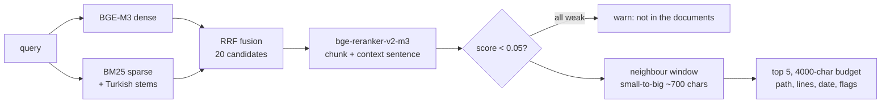

# Semantic Retrieval Engine

A retrieval engine built from scratch in Python (no LangChain or LlamaIndex), in two parts:

1. **Project memory over MCP.** Indexes a software project's own documents (specs, decision logs,
   reports, notes) and serves them to Claude through the Model Context Protocol. Claude searches the
   project instead of re-reading long files, and writes decisions back as notes. This is the part I
   use daily, and the part this README focuses on.
2. **GraphRAG core.** Gemini extracts entities and relations from a corpus into a Neo4j graph
   with an ontology. Queries combine graph paths, vector search and reranking, with a
   self-correction step and a FastAPI + React dashboard.

Everything runs locally on one machine with an 8 GB GPU. Gemini is optional and is used only at
indexing time.

## Project memory: how a query is answered



| Stage | What it does | Why |
|---|---|---|
| Hybrid recall | BGE-M3 dense vectors plus a custom BM25 sparse vector in Qdrant, fused with Reciprocal Rank Fusion | Dense finds meaning, BM25 finds exact decision ids, file names and numbers |
| Turkish morphology | Snowball stems are indexed next to surface forms, and query stems get weight 0.25 | "kararları" should match "karar" without drowning exact matches |
| Contextual chunks | Gemini Flash-Lite writes one sentence per chunk ("where this sits, what it covers"). Each document is sent once with all its chunks numbered. Results are cached by chunk hash | Short decision lines do not say what topic they belong to. One call per document instead of one per chunk cut the cost about 10x |
| Rerank | Cross-encoder over chunk plus context sentence, with a calibrated relevance threshold | Abstains instead of returning confident noise |
| Small-to-big | Matching runs on small chunks. Claude receives each hit with its neighbours, merged when windows overlap | Precise matching, readable context, no duplicates |
| Budget | 5 results, at most 4000 characters, each with path, line range, modification date and flags | Keeps Claude's context small (the main complaint from real use) |
| Freshness | Results flag files changed or deleted since indexing and notes replaced by newer ones. A polling watcher re-indexes about 10 s after a save | Stale answers were the second complaint |

### MCP tools

`search` (filters: folder or file, date range, doc type; 2-4 questions per call) · `overview` ·
`list_documents` · `get_document` · `add_note` (can supersede an older note) · `add_document` ·
`index_status` (git-status style: new, changed, deleted) · `sync_project` · `list_projects`

The server speaks MCP over stdio (Claude Code) and over Streamable HTTP (claude.ai custom
connectors) with token or OAuth 2.1 + PKCE authentication. It is written without the MCP SDK.

## Measured, not guessed

Every change was measured on a golden set taken from the real project: 54 questions in six
groups (decisions, status, numbers, cross-document, inflected Turkish forms, and 12 questions the
documents cannot answer). Run it with `python -m backend.knowledge.eval <project>`.

| Step (same 54 questions) | Hit@1 | Hit@3 | MRR | Off-topic flagged | False "not found" | p50 latency |
|---|---|---|---|---|---|---|
| Stems + neighbour windows (MiniLM, mMiniLM reranker) | 0.76 | 0.93 | 0.85 | 0.92 | 5% | 0.16 s |
| BGE-M3 + bge-reranker-v2-m3 | 0.79 | 0.93 | 0.85 | 0.92 | 0% | 0.33 s |
| + Gemini context sentences, also shown to the reranker | **0.81** | **0.93** | **0.87** | **1.00** | **0%** | 0.31 s |

Earlier steps used a smaller set. Moving the models to the GPU cut the first query from 28-78 s
to under half a second, and warm queries from 3-5 s to about 0.15 s. The model switch was chosen
by an A/B on identical chunks (2 embedders × 2 rerankers). The relevance threshold is calibrated
from the score gap between answerable and unanswerable questions. Contextual indexing of 78
documents (2,436 chunks) took 80 Gemini calls and cost $0.09.

Caveat: the questions reuse the documents' own wording, so these numbers are optimistic. That
is the case where contextual chunks help least.

## Research agent

`python -m backend.knowledge.agent "question"` runs a ReAct loop with Gemini over the same tools.
It splits the question into sub-questions, searches, rephrases when results are weak, opens a
document when a chunk is not enough, and answers with `[path]` citations or says it could not find
the answer. The project is fixed by the caller, never chosen by the model.
`--eval` scores it on the golden set:

| Agent (Gemini Flash, 54 questions) | First run | After fixes |
|---|---|---|
| Cites an expected document (42 answerable) | 0.88 | 0.88 |
| Says "not found" when it should (12 unanswerable) | 0.58 | **1.00** |
| Tool calls per question | 2.3 | 2.2 |
| Median time per question | 9.1 s | 9.5 s |
| Cost per question | $0.0037 | $0.0033 |

The fixes: when the model stops without text (or asks for a tool after tools were switched
off), it gets one tool-free follow-up asking for an answer from the evidence so far; and the
prompt makes "not found" the first sentence, which is the only place the scorer looks for it.
The five remaining misses give sensible answers that cite a different document than the gold
set expects.

## Quick start

```bash
docker compose up -d qdrant                  # Neo4j is only needed for the GraphRAG core
python -m venv .venv && .venv/Scripts/pip install -r backend/requirements.txt
cp .env.example .env                         # GEMINI_API_KEY (optional), MCP_HTTP_TOKEN
cp knowledge_projects.example.json knowledge_projects.json   # point "root" at your project
python -m backend.knowledge.sync my-project  # index; add --full after model changes
claude mcp add rag -- python -m backend.mcp.server            # Claude Code, stdio
python -m backend.mcp.http_server            # HTTP for claude.ai (127.0.0.1:47821, put a tunnel in front)
```

Per-project options in `knowledge_projects.json`: `include`/`exclude` globs, `contextual`
(Gemini context sentences), `watch` (folder watcher). `_default_project` sets the default.

## Layout

```
backend/knowledge/   project memory: bm25, store (Qdrant), search, sync, watcher, contextual, agent, eval
backend/mcp/         MCP server (stdio + HTTP), OAuth 2.1 provider
backend/pipeline/    GraphRAG core: chunker, Gemini extractor, Neo4j graph writer, self-correction
backend/query/       GraphRAG queries: entity linking, path search, PageRank risk ranking
backend/api/         FastAPI dashboard;  frontend/  React UI
tools/windows/       autostart for Docker, server and tunnel at logon
```

## Known issues

- With the claude.ai connector in OAuth mode, claude.ai stops sending the bearer token after the
  first few requests. The connector works with a static `X-API-Key` header instead. The OAuth
  endpoints pass their own tests, so the cause is still open.
- Unanswerable and answerable questions are separated by a narrow score margin (0.041 vs 0.069).
  The threshold must be recalibrated after any model or context change.
